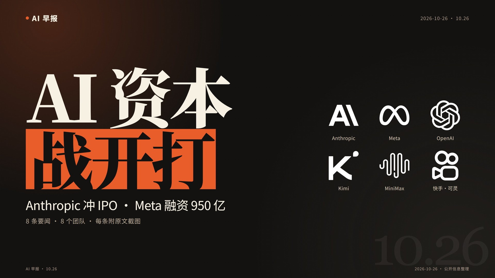
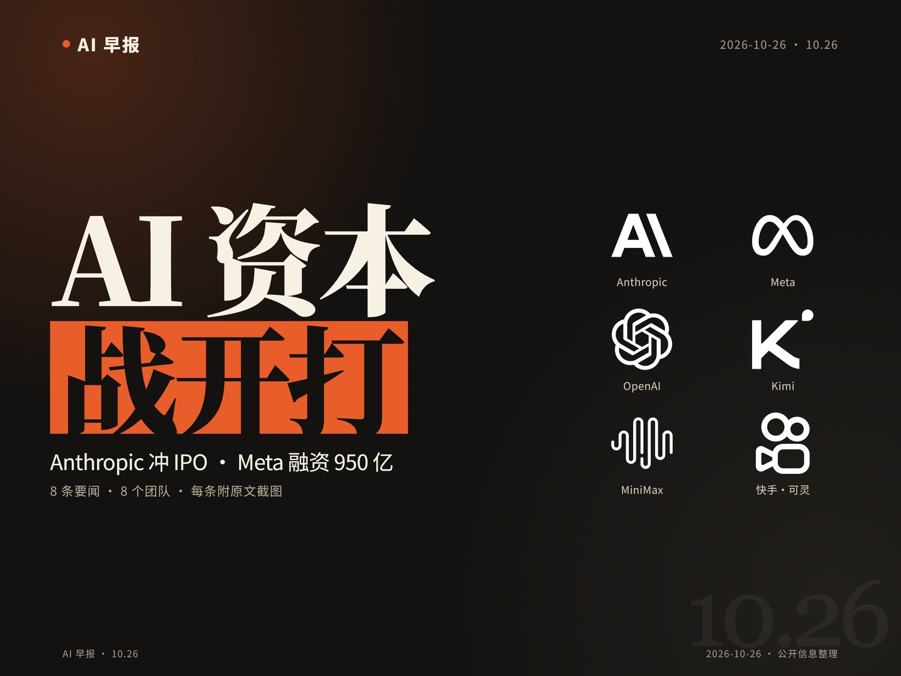

# 封面设计要点

目标：在 B 站信息流里，**320px 宽也能一眼读出钩子、认出厂商**，愿意点进来。不是把视频封面屏缩成一张图。

## 先看图

- 本地参考拼图：`references/assets/cover-reference-bilibili.png`（用户提供的 B 站 AI 日报缩略图集合，仅本地版式研究，不随公开仓库分发）
- 自绘 16:9 示例：`references/assets/cover-example-16x9.jpg`
- 自绘 4:3 示例：`references/assets/cover-example-4x3.jpg`





## 版式骨架

```text
16:9（1920×1080）
┌──────────────────────────────────────────────┐
│ AI 早报                              日期/期号 │
│                                              │
│  AI 资本                    [logo] [logo] [logo] │
│  战开打（橙色块）            [logo] [logo] [logo] │
│  Anthropic 冲 IPO · Meta 融资 950 亿           │
│  8 条要闻 · 8 个来源 · 每条附原文截图           │
│                                      10.26（水印）│
└──────────────────────────────────────────────┘
```

```text
4:3（1440×1080）
┌──────────────────────────────────────┐
│ AI 早报                      日期/期号 │
│                                      │
│  AI 资本               [logo] [logo]  │
│  战开打（橙色块）        [logo] [logo]  │
│  Anthropic 冲 IPO…      [logo] [logo]  │
│  8 条要闻…                            │
│                             10.26 水印 │
└──────────────────────────────────────┘
```

## 当前尺寸（make_covers.py）

| 元素 | 16:9 | 4:3 |
|---|---|---|
| 画布 | 1920×1080 | 1440×1080 |
| 钩子字号 | 250px | 192px |
| 钩子行数 | 1–3 行 | 1–3 行 |
| 橙色强调块 | 最后一行，`#E85D2A` | 同左 |
| 副钩子 | 48px | 34px |
| 信息行 | 24px | 20px |
| logo 图 | 116px | 98px |
| logo 标签 | 19px | 17px |
| 左右边距 | 100px | 80px |
| 栏间距 | 24px | 16px |
| 背景/文字 | `#141210` / `#F7F1E4` | 同左 |

logo 墙：16:9 为 3×2，4:3 为 2×3；最多 6 个，不要塞满。

## 文案公式

1. **钩子**（`hook_lines`）：2–6 字/行，先冲突或结果，再落事实。
   - 好：`AI 资本` / `战开打`
   - 好：`950 亿` / `砸向 AI`
   - 差：`Anthropic 向 SEC 提交 S-1 文件启动 IPO`（太长，缩略图读不完）
2. **副钩子**（`subhook`）：一行事实，回答“到底发生了什么”。
   - `Anthropic 冲 IPO · Meta 融资 950 亿`
3. **信息行**：`8 条要闻 · 8 个来源 · 每条附原文截图`，可保留品牌信任。
4. **不要**在封面上放 8 条索引、长摘要、日期以外的元数据。

## 事实红线

- 钩子可以有情绪，但不能编造数字、时间、因果。
- “冲 IPO”必须有 S-1/招股书依据；“融资 950 亿”必须能在原文找到。
- 不用“炸了/疯传/全网首发”这类无信息量词替代事实。

## Logo 规则

- 用 `cover.logos` 指定 key：`openai/anthropic/meta/kimi/minimax/kuaishou/vllm/deepseek`。
- 素材在 `assets/logos/`（Simple Icons，CC0）；商标归各厂商，仅用于资讯标注。
- 深色封面对黑色 SVG 做 `filter: brightness(0) invert(1)`。
- 缺图时自动退化为文字标；不要把 logo 拉伸变形。
- 最多 6 个，优先本片真正涉及的厂商。

## 自检

- 把封面缩到 320px 宽：第一行钩子还能读吗？logo 还能认吗？
- 3 秒内能说出“谁 + 发生了什么”吗？
- 大字有没有压住橙色块/logo/日期？
- 是否还在用索引小字凑信息？删掉。
- 钩子是否能在 `content.json` 的 8 条新闻里找到事实依据？
